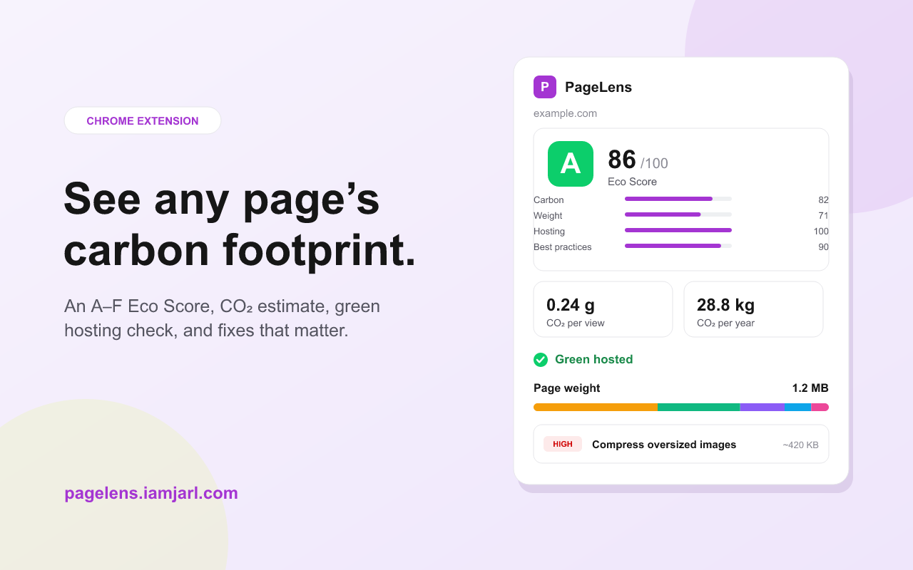

# PageLens

See the carbon footprint of any web page, an actionable A–F Eco Score, right in your browser.

<!-- IAMJARL README store block for PageLens (en). Generated from apps.json, v1.34.0. Do not edit. -->
<p>
  <a href="https://chromewebstore.google.com/detail/pagelens/mkajolhhjdlpmjlgdfnmbhfpbbeebgja?utm_source=github"><picture>
    <source media="(prefers-color-scheme: dark)" srcset="https://raw.githubusercontent.com/JarlLyng/iamjarl-design/v1.34.0/badges/chrome-web-store-border.png">
    
  </picture></a>
  <br>
  Free · <a href="https://pagelens.iamjarl.com">pagelens.iamjarl.com</a>
</p>

<p>
  
</p>

PageLens takes the bytes your browser recorded while loading the page you're on and estimates the CO₂ of one view with [CO2.js](https://www.thegreenwebfoundation.org/co2-js/) and the Sustainable Web Design model. It asks [The Green Web Foundation](https://www.thegreenwebfoundation.org/) whether the site's host runs on green energy, then gives the page an A–F Eco Score and a list of what to fix first, such as oversized images or heavy JavaScript. It's an estimate from an open model, not a measurement, made for developers, designers and sustainability teams who want lighter pages. The page is analyzed in your browser, and the only thing about it that leaves is its hostname, for the green-hosting check.

## For developers

<p>
  <a href="https://madebyhuman.iamjarl.com"><picture>
    <source media="(prefers-color-scheme: dark)" srcset="https://madebyhuman.iamjarl.com/badges/co-created-white.svg">
    </picture></a>
  <a href="https://github.com/JarlLyng/PageLens/actions/workflows/ci.yml"></a>
  <a href="LICENSE"></a>
</p>

PageLens is a Chrome extension (Manifest V3). This half covers what it does in
detail, how to build and run it, how it is put together, and how to contribute.

### Features

- **Eco Score:** one 0–100 score, graded A–F, blending carbon, page weight,
  green hosting and best practices.
- **Carbon estimate:** grams of CO₂ per view plus a yearly projection from the
  monthly visits you set, via [CO2.js](https://www.thegreenwebfoundation.org/co2-js/)
  (Sustainable Web Design model).
- **Green hosting:** whether the site runs on green energy, via
  [The Green Web Foundation](https://www.thegreenwebfoundation.org/).
- **Page-weight breakdown:** transferred bytes by type (HTML, JS, CSS, images,
  fonts, video) and third-party share.
- **Recommendations:** a prioritized list of what to fix first.
- **Deep scan (opt-in, dev build):** a DevTools-Protocol scan for exact transferred bytes
  and real unused JavaScript & CSS.

PageLens gives an **actionable estimate, not an exact measurement**, and is
open about how the score is calculated: see "How this is calculated" in the
popup and [docs/ARCHITECTURE.md](docs/ARCHITECTURE.md).

### How it works

1. **Measure:** reads the page's transferred bytes via the browser's Resource
   Timing API.
2. **Estimate:** feeds those bytes to CO2.js, adjusted for green hosting.
3. **Score & advise:** turns the result into an A–F Eco Score with a
   plain-language list of improvements.

The **quick scan** needs no special permissions. The optional **deep scan**
attaches `chrome.debugger` and reloads the page to measure exact bytes and real
unused code. It shows Chrome's debugger banner, so it is a dev-build feature:
the published Web Store build omits it for faster review.

### Getting started

Requires **Node 24** (see [`.nvmrc`](.nvmrc)).

```bash
npm install
npm run dev     # HMR build → dist/, hot-reloads the loaded extension
npm run build   # production build → dist/
npm test        # unit tests (vitest)
npm run lint    # eslint
npm run format  # prettier --write
```

**Load it in Chrome:** open `chrome://extensions`, enable **Developer mode**,
click **Load unpacked**, and select the `dist/` folder.

### Project structure

```
src/
  core/          Pure, framework-free analysis engine (unit-tested)
                 classify · aggregate · carbon · score · recommendations · coverage
  background/    MV3 service worker + chrome.debugger deep scan
  content/       Injected Performance-timing collector
  popup/         React UI (components, hooks)
  lib/           Messaging, Green Web Foundation client, storage, settings
tests/           Vitest suites for core/ (incl. score calibration)
site/            Marketing site (Vite + React) → pagelens.iamjarl.com
docs/            Architecture & Chrome Web Store guides
scripts/         Dependency-free icon generator
```

The analysis logic in `src/core/` is deliberately pure, with no `chrome.*` or
DOM access, which keeps it fully unit-testable. Chrome APIs live only at the
edges.

### Tech stack

React · TypeScript · Vite · [`@crxjs/vite-plugin`](https://crxjs.dev/) ·
Tailwind CSS · Chrome MV3 · CO2.js · Green Web Foundation API

Styling uses the [iamjarl-design](https://github.com/JarlLyng/iamjarl-design)
token system, mapped onto Tailwind and auto-switching light/dark.

### Quality

Every push and PR runs lint, format check, type-check, unit tests, and a
production build via [CI](.github/workflows/ci.yml). The Eco Score thresholds
live in `src/core/constants.ts` and are pinned by
[`tests/calibration.test.ts`](tests/calibration.test.ts).

### Publishing

The published build omits the `debugger` permission:

```bash
npm run package:store   # → pagelens-store.zip from a debugger-free dist-store/
```

See [docs/chrome-store-listing.md](docs/chrome-store-listing.md) for the full
release process and [PRIVACY.md](PRIVACY.md) /
[the hosted policy](https://pagelens.iamjarl.com/privacy.html).

### Feedback & support

Email **support@iamjarl.com**, or use **Send feedback** at the bottom of the
popup, which fills in your version. Bug reports and ideas are just as welcome as
[GitHub issues](https://github.com/JarlLyng/PageLens/issues).

### Contributing

Contributions are welcome: see [CONTRIBUTING.md](CONTRIBUTING.md) and the
[Code of Conduct](CODE_OF_CONDUCT.md). For security issues, see
[SECURITY.md](SECURITY.md).

### License

[MIT](LICENSE) © IAMJARL
